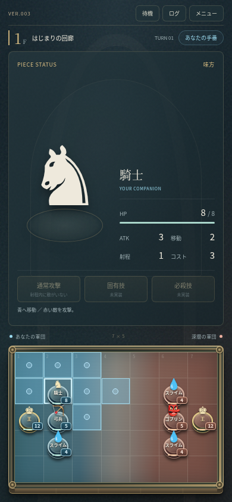
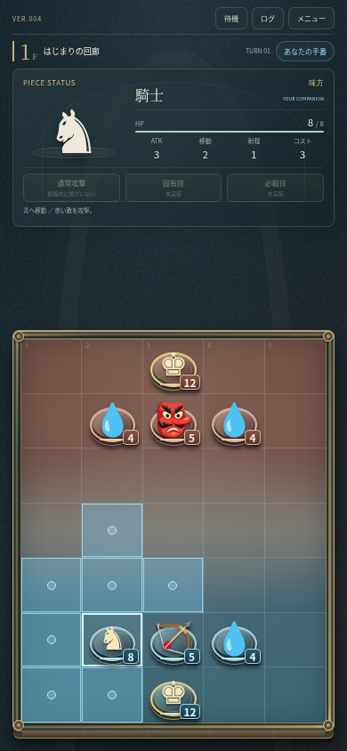
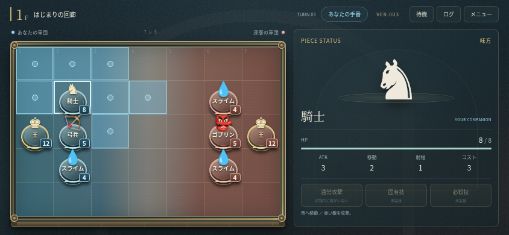
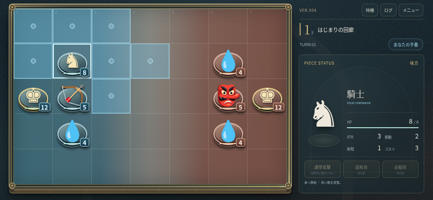

# VER.003 → VER.004 表示比較

2026年11月26日、Chromium、同一ビューポート、セーフエリア値0で測定。盤面本体の寸法（枠・側面を除く）。スクリーンショットは初期軍団の騎士を選択した状態で、表示内容は加工していない。

| 画面サイズ | VER.003 幅×高さ(px) | VER.004 幅×高さ(px) | 盤面面積 |
| --- | ---: | ---: | ---: |
| 390×844 | 339.98×218.55 | 342.00×430.91 | +98.34% |
| 375×667 | 324.98×208.91 | 307.14×386.98 | +75.07% |
| 320×568 | 280.00×180.00 | 234.91×295.97 | +37.95% |
| 844×390 | 437.11×280.98 | 532.00×342.00 | +48.14% |
| 667×375 | 390.00×250.70 | 410.00×263.56 | +10.52% |
| 812×375 | 413.77×265.98 | 508.66×326.98 | +51.13% |
| 844×330 | 365.55×234.98 | 446.44×286.98 | +49.15% |
| 1440×1000 | 1043.00×670.50 | 1093.00×702.64 | +9.82% |

縦は表示の列数・段数も変わる。VER.003は横7列×縦5段、VER.004は横5列×縦7段。全方向で各マスの高さ÷幅は0.90を維持。

## 縦画面 390×844

| VER.003 | VER.004 |
| --- | --- |
|  |  |

## 横画面 844×390

| VER.003 | VER.004 |
| --- | --- |
|  |  |
